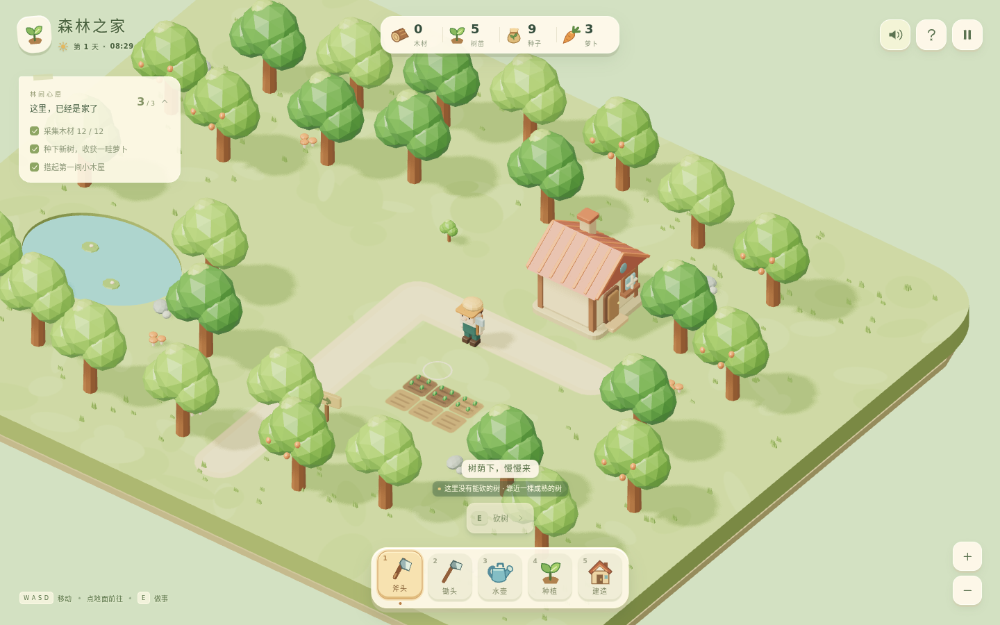

# 森林之家 · Home of Woods

一款以 Q 版森林为舞台的轻量种田 RPG。砍树取材、补种树林、开垦种田、搭建小屋，把一片林间空地慢慢变成自己的家。

**视觉方向：low-poly、圆润的塑料玩具质感、鲜明的大色块、温暖柔和的光照。**

## 当前状态

首个可运行的浏览器单人游戏原型。全屏三维森林就是游戏主界面，进入后直接操纵人物；HUD 只承担工具、背包资源、当前目标和暂停菜单。

已实现行走与点击寻路、采木补种、胡萝卜耕种、建造小屋与围栏、本地保存。采用 TypeScript + Three.js + React HUD，依赖版本由 `package-lock.json` 锁定。当前没有生产部署地址。



[手机竖屏](docs/screenshots/mobile.png) · [手机横屏](docs/screenshots/mobile-landscape.png) · [建造预览](docs/screenshots/desktop-build-preview.png)

## 本地启动

需要 Node.js 24 与 npm。

```bash
npm ci
npm run dev
```

打开终端显示的本地地址。生产构建运行 `npm run build`，生成静态资源到 `dist/`。

## 操作

| 操作 | 键鼠 | 触屏 |
| --- | --- | --- |
| 行走 | WASD / 方向键；斧头/水壶模式点击地面自动绕行 | 左侧摇杆；斧头/水壶模式点地面 |
| 选目标 | 点击树、田地或空地 | 点选场景目标 |
| 换工具 | 1–5，或底部工具栏 | 底部五格工具栏 |
| 使用工具 / 收获 | E 或场景聚焦时空格 | 右侧主动作按钮 |
| 种植 | 选择种植，再选树苗或萝卜 | 同一操作 |
| 建造 | 选择小屋/围栏，点空地，R 旋转，确认 | 预览、旋转与确认按钮 |
| 暂停 | Esc；建造模式下先取消建造 | 右上暂停按钮 |

锄头、种植和建造模式中的地面点击用于选择操作位置；键盘或摇杆仍可随时移动。

靠近成熟树，挥斧三次获得 4 块木材与 1 棵树苗。收集 12 块木材即可建造小屋。树苗用 90 秒游戏时间长成大树；萝卜播种、浇水后用 35 秒成熟。暂停与后台不推进成长。

进度保存在当前浏览器的 `home-of-woods-save-v1` 存档槽。原始存档损坏或版本无法识别时保留原数据，并暂停覆盖；界面显示保存状态。

## 检查

```bash
npm run check
npx playwright install chromium
npm run dev
# 在另一个终端运行
npm run check:browser
npm run check:lifecycle
```

检查包括类型、玩法、寻路、存档与循环生命周期，以及真实 WebGL 场景中的键鼠/触屏流程和固定状态截图。浏览器证据使用独立临时浏览器上下文；日常存档不参与测试。详情见 [首版验证记录](docs/VERIFICATION.md)。

## 核心文档

| 文档 | 用途 |
| --- | --- |
| [玩法与首版范围](docs/GAME_DESIGN.md) | 核心循环、状态规则、阶段验收 |
| [渲染与模块管理](docs/RENDERING.md) | 模块边界、统一循环、空间与资源生命周期 |
| [美术与 HUD](docs/ART_HUD.md) | 塑料玩具森林、交互布局、视觉验收 |
| [开发约定](AGENTS.md) | scope、文档同步、验证与交付 |
| [首版施工范围](docs/scopes/first-playable.md) | 本轮范围、入口与验收 |
| [实际验证记录](docs/VERIFICATION.md) | 检查结果、实机截图、资源记录与限制 |

## 第一段可玩体验

在一小片可步行的森林空地里，完成砍倒一棵树、获得木材、种下一棵树苗、收获一块田，并放置一间小屋。刷新后，树林、田地、建筑和背包仍保持刚才的状态。

渲染和 HUD 的组织方式借鉴同作者的「水晶花园」：保留清楚的职责与释放规则，以本项目的小规模需求重新组织。
