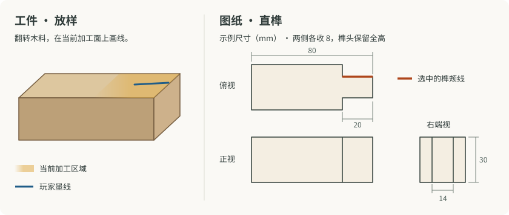

# 木作图纸、放样与加工

**设计基线 · 2026-11-07。直榫样件已在沙盒验证（verified-sandbox），多部件家具仍属规划。**

玩家在工作台前决定一张凳子的高矮和宽窄，再读零件图、挑料、划线、下锯，最后试装。图纸给出准确的目标，墨线记录玩家对图纸的理解，加工后的工件决定下一步还能怎么做。基础配方仍可用预设工序完成。想亲手定尺寸、修配时，才需要逐件读图。

主线已有粗木工作台、参数化长凳和边桌，以及支撑和面板的引导装配。现有装配虚线用于对齐已备好的部件。本文约定的是备料到试装之间的手作流程。实施时沿用[参数化图纸与装配评分](PARAMETRIC_CRAFTING.md)、[工作台与营地物件](CAMP_LIFE_INTEGRATION.md)和[木料规格](ACTION_WOOD_INTEGRATION.md)。

首轮直榫已在[独立练习台](../sandbox/woodworking/README.md)完成沙盒验证。可试玩范围和回接前置见[本期记录](scopes/woodworking-handwork-sandbox.md)。下文保留完整设计。

## 从整件构思到台面放样

| 时机 | 玩家看到什么 | 玩家做什么 |
| --- | --- | --- |
| 构思整件 | 可旋转的成品预览。长凳可调整长宽、高矮和支撑数 | 在图纸允许的范围内定形。确认时短暂呈现整件立体印象，随后展开本件的零件图 |
| 选料 | 零件规格，以及木料的实际长度、截面和顺直度 | 为当前零件挑一根放得下目标轮廓的料，决定余量留在哪头 |
| 第一次看工件 | 目标零件在所选木料上短暂显影，随后淡出。约五秒为试玩初值 | 可以趁这几秒比划或开始画。虚影淡去时，已画的笔迹留在木料上 |
| 读图划线 | 右侧常驻同一零件的正、俯、侧视图，准确标出尺寸、基准和当前加工线。左侧是可自由翻转的实际工件 | 在图上选一道线，转动工件，找到对应的面，用基准边判断距离，画下自己的墨线。落刀前可重画，读图和划线不限时 |
| 加工与复查 | 当前刀具、进刀方向，以及刚加工出来的真实表面 | 确认墨线后进刀。下一道工序在现有表面上继续放样，或把工件拿去试装 |

选中图线时，镜头可转到便于观察的大致方向，玩家仍能自行翻面。左侧用一片宽热区提示工作面和可能下刀的部位。同一块热区内应能画出几条位置明显不同、看起来都合理的线，具体该画哪条仍须读图。热区没有对准目标的亮脊、中心标记或吸附点。切换加工线、翻面或反复点选时，也不能拼出一条精确投影或反复唤回虚影。三视图始终可查。短暂显影只用于建立空间印象。桌面并排对照，窄屏可上下排布，参照图和正在画的木面都应可见。

## 一道工序怎样交给下一道

图纸规定零件如何连接、哪些面必须承托或贴合，以及尺寸可选范围、目标几何、公差和工序顺序。玩家选择的合法尺寸直接成为本件目标。三视图、短暂虚影和试装要求应由同一组目标参数生成。

墨线附着在工件自己的面上，保存局部位置和方向。初期手锯按玩家的线执行，避免随机漂移掩盖划线偏差。普通直切以一面上的墨线和约定的进刀方向定出切面。需要从两面确定的切面，则在相邻面分别放样，两条线须能定义同一切面。局部锯切还要有明确止点，例如纵锯到榫肩为止。留料侧、废料侧和进刀方向在落刀前可辨认。

每刀只更新影响后续操作的低面数工件几何，例如实际长度、截面、端面位置与倾斜，以及已经形成的肩、槽或孔。切掉的区域连同其上的笔迹一起移除，保留部分的墨线仍随工件翻转。下一步若要在新端面划榫颊线，或在切平的面上画孔位，就等那个面真正露出来再开放。够规格的余段可按实际剩余尺寸再作小件，材料结算沿用同一库存事务。

## 第一个可玩样件 · 带直榫的方木

用一根方木做两侧收窄的直榫，另一边先备好试配槽。这个样件只需手锯做几个方向的直切，已经可以检验翻面读图、新面放样、止锯深度和试装。下图尺寸仅用于说明。

1. **截端。** 在略长的方料上画横截线，锯出端面。这个实际端面是后续量榫长和画榫宽的基准。
2. **画肩和颊。** 从端面向内量榫长，在外侧面画榫肩线。翻到新端面，按图画出界定榫宽的两条榫颊线。以图中的 30 mm 方料为例，中间保留 14 mm，两侧各有 8 mm 待去除。俯视图高亮其中一条榫颊的上缘，玩家可把端面的标记引到顶面，指明纵锯走向。
3. **锯至相交。** 从端面沿两条榫颊线纵锯，到榫肩位置收锯，再从两侧沿榫肩横锯至纵向锯缝。锯缝相接时，两块废料脱离，露出榫颊和榫肩。
4. **试配。** 刻意把一侧榫颊画在目标以外，使榫头偏厚。锯子应沿这条偏线切，塞入预制槽时应看得出哪一侧干涉。退出、修掉高出的一侧再试。修得过薄则留下间隙，评分反映最终配合。

## 试装、工艺分和成品

先按图纸检查必需连接、接触、干涉和硬公差。超差时在试装位置指出碰壁、悬空或无法就位的那一侧，玩家据此决定能否通过减材返工。通过后，再按最终尺寸、接缝贴合、支撑平齐程度等与该物件有关的指标计算工艺分。同一处墨线画偏一路传到成品，只按最终后果计一次。

例如，两侧支撑同样略短的长凳，坐面仍可水平，只在目标高度上略有差异。仅一侧偏短则可能让坐面倾斜或一端接不实。玩家可以修短另一侧，拿一点高度换回平齐。硬公差和评分权重应随具体图纸试玩调整。工艺分继续修正图纸允许范围内的成品稀有度概率，词条使用成品原有规则。

完工时把试装结果收敛成一个独立道具。长凳的轮廓包络需保留实际长宽、坐高、可见倾角和支撑分布，凳下留空、坐点和占地应与成品外形一致。装配结束即可释放临时零件几何、墨线和刀路。制作中的数据随既有 `WorkshopJob` 管理，工序接入 `CraftProfile.steps`，成品几何与工艺结果回到现有物品实例。

普通刷漆先支持单色表面。颜料决定木作的底色，色彩词条另行决定作用部位、触发与表现。重刷底色保留原有词条及稀有度。若以后开放拆解，回收依据来自成品定义和最终规格，无须还原制作时的散件。拆解产物、比例和损耗留待单独设计。

## 工具随工序开放

| 开发顺序 | 新能力 | 玩家能感到的变化 |
| --- | --- | --- |
| 先做直榫样件 | 基础手锯，横切及有止点的纵切 | 读几个方向的图，手画的线会真实改变工件，锯厚了还能自己修配 |
| 接入成品家具 | 复用长凳和边桌的装配，逐步添直角尺、划线规或工作台挡块 | 直角尺辅助作垂线，划线规从所选基准边保持等距，挡块让后续支撑沿用第一件的长度 |
| 按下一件物品扩展 | 削刀修轮廓，凿子挖槽，手钻开孔。再按需求引入夹具、刷漆 | 工具增加可做的形状，改良工具扩大可加工规格或让重复操作更稳。对应物件用得到时再加入该道工序 |

首轮用同一根直榫验收。虚影消失后还能查图并在宽热区内自由落笔。一条故意错开的线确实造成试配干涉。返工修去对应余量后可以装入。接长凳时，再检查完工、摆放和坐下看到的都是玩家实际做出来的尺寸。
