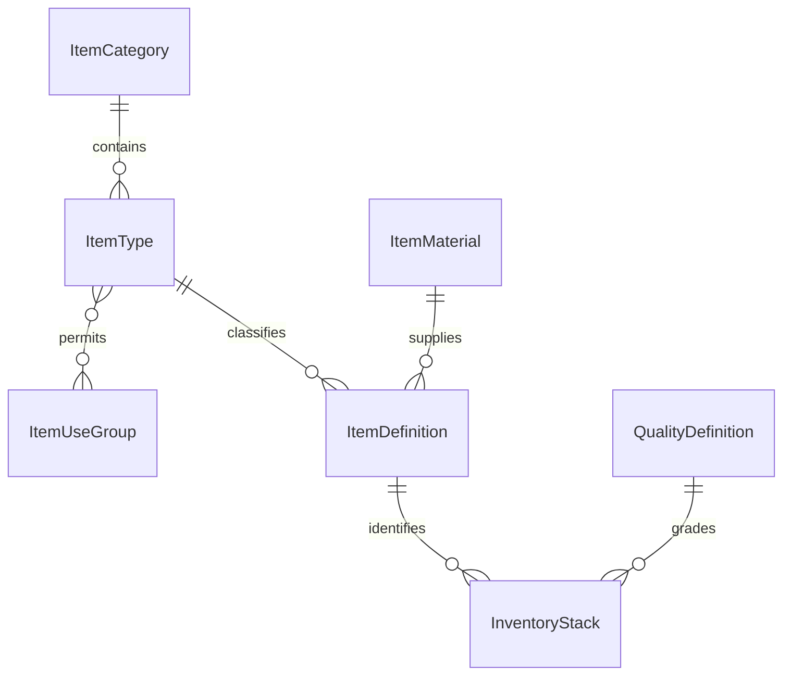

# 世界存档与物品目录

日期：2026-10-30。当前实现统一保存现有世界的时间、角色、库存、林业额度、树木代次、采集资源池及动作。具体菌种、木种、加工、交易和建筑玩法仍按后续功能接入。本轮范围见 [scope](scopes/world-save-and-item-types.md)，实际测试与截图见 [存档证据](../evidence/world-save/README.md)。

## 物品目录与玩家持有记录

AzerothCore 的 [item_template](https://www.azerothcore.org/wiki/item_template) 使用独立物品 ID、class 与 subclass；[item_instance](https://www.azerothcore.org/wiki/item_instance) 通过 itemEntry 引用模板，并记录持有者、数量、耐久等实例信息。本项目采用目录与持有记录分离、明确类型引用的原则；普通材料仍按物品和品质堆叠。

[item-types](../src/content/item-types.ts) 是类别、类型、材质和通用去处的目录；[items](../src/content/items.ts) 登记物品 ID 及其引用。类型约束类别、形态与资源线，材质显式允许所属类别，通用去处明确允许的资源线。注册器拒绝重复或悬空引用、类型/类别/形态矛盾，以及枝料类型连接结构木用途的配置。

新增同类型物品只需登记新物品 ID 和材质等定义，继承该类型已有的通用去处；不复制用途业务代码、不改库存格式。新增类别和类型也通过目录登记，仓库分类、类型名称和通用去处由目录派生。用途目前是计划中的修缮、木作、林产保存/交换入口，不代表已经开放制作或交易。

存档只保存玩家实际拥有的 `itemId + qualityId + quantity`。物品名称、类别、类型、材质和用途目录不随每份存档重复保存；目录增项或重排不会重写旧库存。稳定 ID 的旧语义必须保留，未知物品/品质以不可消费的待识别记录无损保存，详见 [物品兼容](ITEM_DATA_EVOLUTION.md)。

## 唯一世界快照

[world-save](../src/domain/world-save.ts) 的 v1 信封包含 schemaVersion、layoutVersion、rulesetVersion、sequence、savedAt、world 和 SHA-256 checksum。世界切片包括：

| 切片 | 保存内容 |
| --- | --- |
| seed、time | 固定世界身份与单调游戏时间；真实离线时间不推进模拟 |
| player、selected、route、visited | 地表坐标、朝向、移动状态、选择、路径顺序与探索地点 |
| inventory | 稀疏品质堆叠；事务 revision 在读档后重建，不写入持久切片 |
| forestry | 年度基础/已用/预留额度、逐树位个体与代次、出生/成熟/补生时间、活动采伐与完成动作 ID |
| gathering | 每处资源池余量、版本、恢复记录、宿主个体、活动动作、结算 ID 与下一个动作序号 |

布局和规则版本有独立含义；新增目录记录不要求改存档 schema。物理布局或结算规则发生不兼容变化时，必须提供相应迁移，旧客户端遇到未来版本会保护原档。

校验器先验证所有切片与引用，再返回完整候选状态。校验包括：树位与代次身份、宿主与资源池状态、预留额度与进行中采伐、已完成动作与树木阶段、采集来源版本、计数器、结算标记、目标和路径。来源加载、模型重建与读档均不补满资源池、不刷新额度、不重抽个体。

序列化先同步捕获完整候选，再异步计算摘要，避免把两帧的库存和树木拼进同一存档。对象键顺序规范化，路径和动作历史的数组顺序保持原样。摘要用于发现意外数据变化，不承担联网游戏的防作弊职责。

## 动作恢复与一次结算

开始采集时冻结物品、品质、数量和耗时；开始采伐时冻结物品、品质、产量和预留体量。已开始动作不因之后的目录调整重新决定产物。

进行中的采集恢复来源 ID、来源版本、走近路径、开始时间与进度；完成动作同时保存来源扣减、库存增加和结算标记。进行中的挥斧恢复预留与树木个体；进入倒伏时，原木、已用额度、释放预留、完成 ID 与补生安排已一起结算。恢复倒伏或树桩只继续表现和到期转换，不能再发木材。

完整读档后先暂停，继续后才推进动作。场景卸载停止循环并保留动作状态；移动、改目标或明确取消仍按原规则取消。当前没有离线收益，页面关闭多久都不会凭真实时间补发物产。

## IndexedDB 事务与备份

[world-save-store](../src/app/world-save-store.ts) 是唯一持久写入适配器：数据库 `home-of-woods-save-v1`，版本 1，object store `world`，记录键 `primary` 和 `backup`。新增物品目录不升级数据库结构。

每次保存先编码并校验整个世界，再在一个严格持久化 readwrite 事务中比较主档与备份的原始值，确认仍是本控制器读取的版本，随后把上一份有效主档写入备份、候选快照写入主档。事务完成后才显示“世界已保存”；事务失败时两条记录都不提交。其他页面抢先保存会导致比较失败，本页进入需重读状态，不覆盖赢家的数据。

[save-controller](../src/app/save-controller.ts) 由 App 创建并跨场景重入复用。自动保存借用现有循环：普通状态每 5 个游戏秒检查，进行中动作每 1 个游戏秒检查；资源/额度/动作阶段变化立即请求快照。暂停、隐藏、退出和手动保存也请求完整快照；当前保存状态明确显示，页面关闭期间未完成的写入不宣称成功。所有保存都包含完整世界，库存和额度不分开恢复。

控制器只缓存已验证的不可变检查点；load/reload 返回独立副本，首次新世界保存后也返回最新已提交版本。读取缓存不会与运行中的 GameState 共用可变子对象，备份也不会随着角色继续游玩而被改动。

## 损坏档保护与恢复入口

主档或备份若存在坏 JSON、错误摘要、未来结构、非法数值或跨切片矛盾，自动和手动普通保存都会被阻止，原记录保持原样。读取失败也不会被当成一个可写的新世界。只有有效备份且主档缺失时，才可直接读取该备份；任何已存在的损坏记录都等待明确恢复操作。

暂停菜单提供保存世界、重新读取、导出主档/备份与有效副本恢复。导出保留原始文本，损坏 JSON 也可原样导出。恢复有效副本是明确的替换操作：重新校验副本并检查原记录未被其他页面改动，再用一次事务替换主档与备份，成功后才替换运行时世界。原主档、坏备份或临时游玩的数据不会在加载失败时自动覆盖。

如果浏览器存储写入失败，上一份有效世界仍保留，界面显示失败并允许重试或导出。浏览器站点数据被用户清除、不同来源或不同浏览器配置之间的存储隔离，不由存档迁移解决；跨来源迁移以后通过明确的导入流程扩展。

## 后续功能的接入条件

当前快照覆盖现有全部玩法状态。建筑、加工任务、交易或年度事件出现时，需先加入保存结构、跨切片校验和迁移，再开放对应玩法；不得靠新增一个独立存档写入者接入。耗时加工沿用冻结投入/产物与幂等结算原则。M1 的修屋闭环及建筑存档仍未完成。
